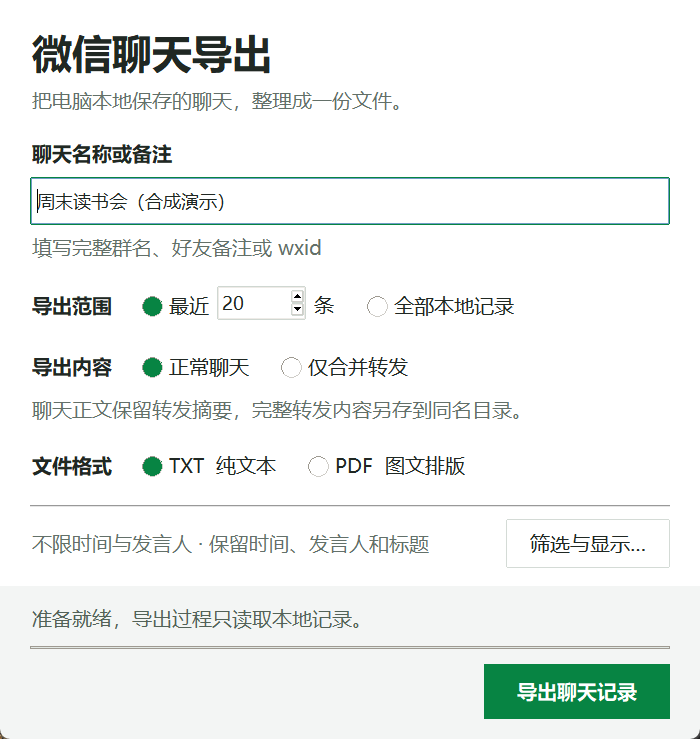
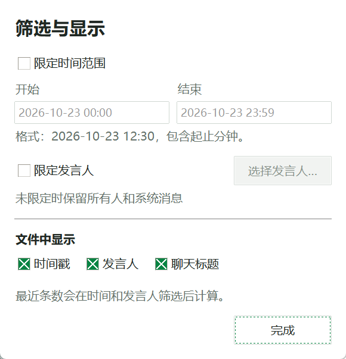

# 微信聊天记录导出与本地备份

面向 Windows 微信 4.x 的本地微信聊天记录导出与备份工具，支持好友聊天、群聊导出 TXT、PDF，提取合并转发的聊天记录，并筛选时间、发言人和最近消息数量。当前仅在部分 Windows 微信 4.x 环境验证；微信更新、数据库格式变化或本地缓存清理可能影响使用。

本仓库提供源码。源码目录不附带可执行程序、微信数据、密钥或导出结果。

## 安装

Windows 程序包与源码压缩包可从 [GitHub Releases](https://github.com/Archwindos/wechat-history-extraction/releases) 下载。程序包包含使用说明和第三方许可；首次连接仍需按下方步骤通过源码生成本机密钥，再将 `private-data` 放到程序旁边。

使用 Windows 10/11、64 位 Python 3.11 或更新版本，在仓库根目录打开 PowerShell：

```powershell
python -m venv .venv
.\.venv\Scripts\Activate.ps1
python -m pip install -r requirements.txt
```

如需导出 PDF，另行安装 [Pandoc](https://pandoc.org/installing.html) 和含 XeLaTeX 的 TeX 发行版，例如 [MiKTeX](https://miktex.org/download)，并将 `pandoc`、`xelatex` 加入 PATH。中文排版需要微软雅黑或宋体；缺少这些工具时仍可导出 TXT。

Release 程序不内置 FFmpeg。处理部分微信图片或表情格式需要自行安装 [FFmpeg](https://ffmpeg.org/download.html)，将 `ffmpeg` 加入 PATH，或通过 `IMAGEIO_FFMPEG_EXE` 指定其完整路径；不可用时相关媒体保留占位。

Release 程序使用系统提供的 Microsoft 运行库。首次运行前，请安装微软官方 [Visual C++ x64 Redistributable](https://aka.ms/vc14/vc_redist.x64.exe)；已有合适版本时可直接使用。

也可通过环境变量 `WECHAT_PANDOC`、`WECHAT_XELATEX` 指定这两个程序的完整路径。微信数据目录可通过 `WECHAT_DATA_ROOT` 设置；首次提取密钥仍需向下方命令传入 `--data-root`。

## 首次连接

先登录电脑版微信，找到本机的 `xwechat_files` 数据目录。首次使用且没有本机密钥时，运行：

```powershell
python tools/setup_local.py --data-root "<微信 xwechat_files 目录>"
```

存在多个账号时，可指定该目录中的账号文件夹名：

```powershell
python tools/setup_local.py --data-root "<微信 xwechat_files 目录>" --account "<账号文件夹名>"
```

将尖括号中的内容替换为自己的路径和账号目录名。提取过程会关闭微信；按终端提示从桌面重新打开微信并完成登录，保持提取命令运行，等待完成。密钥只用于读取本机数据库，保存在本机 `private-data` 中，请勿上传或分享该目录。

## 运行与导出

```powershell
python app.py
```

1. 完成上方首次连接步骤后，启动程序。
2. 填写完整群名或好友备注，确认要导出的聊天。
3. 在主窗口选择“最近 N 条”或“全部本地记录”、导出内容和 TXT / PDF 格式。
4. 需要筛选时，点击“筛选与显示…”设置时间、发言人及是否保留时间戳、发言人和标题；点击“完成”返回主窗口。
5. 点击导出并选择保存位置。完成后，可直接点“打开文件”或“转发目录”查看结果。

时间范围包含起止分钟；“最近 N 条”在时间和发言人筛选后生效。“全部本地记录”导出符合筛选条件的全部记录。主窗口会显示当前筛选和显示设置的摘要，导出过程中会显示进度并锁定输入，避免中途更改条件。





截图展示真实程序界面；“周末读书会（合成演示）”为演示输入。空状态界面用于说明操作位置，不代表已经连接到聊天数据或完成导出。

导出文件及校验清单默认保存到 `exports`，本机设置、密钥和数据快照保存在 `private-data`。已有有效密钥时可以继续使用；密钥失效时需重新运行首次连接步骤。

使用 Release 可执行程序时，首次使用仍需按上方步骤安装源码依赖并运行 `tools/setup_local.py`。该命令在源码根目录生成 `private-data`，而可执行程序在自身所在目录查找 `private-data`；请将自己生成的这个目录放到程序旁边，再启动程序。此操作只在自己的电脑上完成，切勿把密钥与本机数据上传到仓库或分享给他人。当前可执行程序并非完全免配置。

PDF 使用 Pandoc + XeLaTeX，包含本机图片、表情的静态画面，以及可找到的视频预览图。文件封面优先使用本地缩略图；缺失时可尝试生成 PDF 文件首页。Word、PowerPoint、Excel 文件首页需要本机安装对应的 Microsoft Office 程序。

导出过程只使用本机已经保存的聊天和媒体，不联网下载缺失媒体。缓存已清理、文件缺失、格式不支持或无法读取时会保留占位；占位不表示该消息原本没有附件。普通文字导出不需要下载语音转写模型。

## 合并转发聊天记录

“合并转发”指微信中点开后可以阅读多条消息的聊天记录卡片。

- **正常聊天**：主文件标明“合并转发”，只保留卡片标题、最多三行预览及详情文件位置。完整内容自动另存，不会把长篇转发混入日常聊天正文。
- **仅合并转发**：在所选聊天范围中查找转发，主文件作为转发索引。适合单独整理别人发来的聊天记录。
- **多层转发**：转发内还有转发时，也会各自生成详情文件，通过相对文件名关联。选择 PDF 时，索引和详情均为 PDF；选择 TXT 时，均为 TXT。

例如选择保存为 `读书会.txt`，会得到：

```text
读书会.txt                          # 主聊天或转发索引
读书会.txt.manifest.json            # 数量、完整性状态和文件校验值
读书会.txt_转发记录/
    0001_讨论记录.txt               # 第一份转发的完整内容
    0002_参考讨论.txt               # 嵌套的另一份转发
```

请将主文件与转发目录一起保留。为避免覆盖已有资料，重导时请选择新文件名。

筛选时间、发言人以及“最近 N 条”均针对**外层聊天消息**；命中一张转发卡片后，其内部消息完整保存，不再次按外层时间或发言人裁掉。“最近 20 条”表示从最近 20 条聊天中寻找转发，并非最近 20 份转发。时间戳、发言人等显示选项同时应用于详情文件。

只提取消息中已存于本机的内嵌明细。记录损坏、缺少明细或嵌套过深时会明确标注，不把卡片预览当作完整内容。可先在微信中打开该转发，再重新导出。PDF 会尝试按内层消息的媒体标识寻找本地图片、表情、视频预览和文件封面；找不到时保留占位。

## 开发与构建

```powershell
python -m pip install -r requirements-dev.txt
python -m pytest tests
python -m PyInstaller WeChatExport.spec
```

`WeChatExport.spec` 是构建定义。构建结果位于 `dist`；Pandoc、XeLaTeX、字体和 Office 仍需在运行电脑上安装。测试通过不代表所有微信版本、账号数据或媒体格式均已验证。

分发者须检查实际随包依赖的许可证、署名和相应源码交付要求，具体见 [THIRD_PARTY_NOTICES.md](THIRD_PARTY_NOTICES.md)。

如提供 Release，应从整理后的源码重新构建，仅打包程序、使用说明和完整第三方许可文件，并按适用许可提供相应源码及构建资料。不要复制已有的本机使用目录，或将 `private-data`、`exports`、缓存、日志与测试数据放入 Release。

## 来源与许可

`vendor/wechat-decrypt` 包含 [tzwkb/wechat-decrypt](https://github.com/tzwkb/wechat-decrypt) 的最小运行时源码，基于 commit `f0b3f9f95dda2d954ee3dbe1d139fb1944a5ecfd`，含本项目的本地适配修改。上游 MIT 许可证保存在该目录的 `LICENSE`。

媒体格式处理参考 [weflow-cli](https://github.com/zhuobichen/weflow-cli/tree/5ad2fca0c9156224a1a69e4c13b9f81752b6459b) 的固定版本。完整第三方声明及 PyMuPDF、FFmpeg 的分发条件见 [THIRD_PARTY_NOTICES.md](THIRD_PARTY_NOTICES.md)。

本项目采用 [GNU Affero General Public License 第 3 版](LICENSE)（`AGPL-3.0-only`），允许商业使用、修改和再分发，须遵守其开源及相应源码交付等义务。第三方代码继续适用各自许可证，vendored 上游 MIT 声明完整保留。PyMuPDF、MuPDF 及其他随包依赖的具体来源和分发要求见第三方声明。

